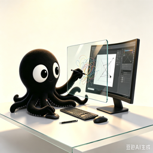
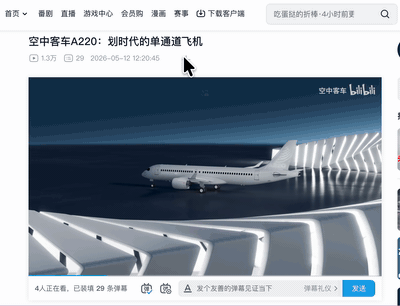
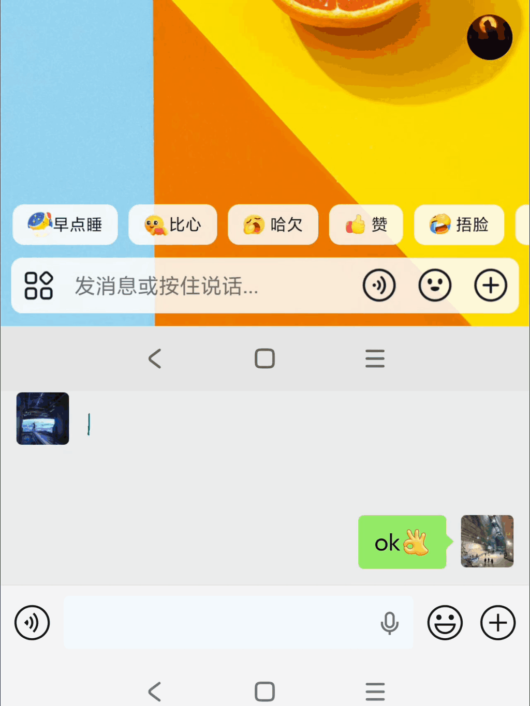
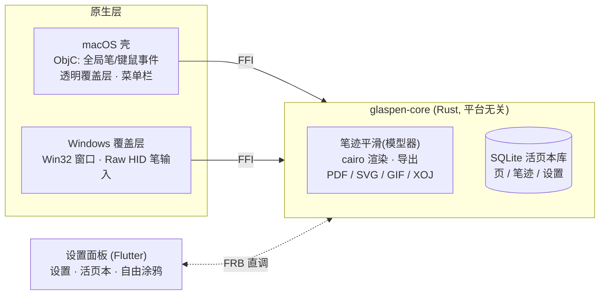

[English](./README_EN.md)

# 玻璃涂鸦

实现了键鼠和数位板的分离.  
相当于在显示器前加了一面玻璃做笔记.

普通的数位笔不在笔记软件中操作时, 会被操作系统当成鼠标, 本人不希望数位笔有鼠标的作用.  
此APP适用于远程会议 远程教学 屏幕标注 临时便签 等场景.

平台:

- Mac OS 12+（当前发布物为 Apple Silicon / arm64）
- Windows 10/11 x64（直接读取 Raw HID, 压感可用, 不依赖 Microsoft Ink）

## 两种画布模式

在设置面板顶部 tab, 或菜单「无限画布」切换; 两种模式的笔迹**独立存储**.

- **活页本(翻页)模式** — 一页一屏, 经典翻页(整页翻转, 窗口原生淡入淡出动效)
  - `⌘⌃~` / `⌘⌃1`: 整页翻到上一页 / 下一页(可在 设置 → 快捷键 中改).
  - 页面网格: **拖拽重排 / 批量多选删除**, 整页视图内**圈选移动/复制/粘贴**.
- **无限画布(自由涂鸦)模式** — 一块没有边界的画布, 目前全局只有一张
  - `⌘⌃I`: 切换自由涂鸦(无限画布).
  - 左手镜头: `⌥W / ⌥S / ⌥A / ⌥D` 平移; `⌥Z / ⌥X` 缩放
    (均可在 设置 → 快捷键 中改).
  - `⌥⌘滚轮` 以鼠标位置为锚缩放(上限 100%).
  - 面板「编辑内容」: 圈选/拖动移动/复制/粘贴/删除(与活页本共用剪贴板).

功能:

- **快捷录制 GIF**
  按住 `⌘⌃R` 涂鸦, 松开手自动把这段涂鸦生成动画 GIF 并复制到系统剪切板.
  设置面板可调帧率 / 分辨率 / 播放速度.

- **导出** 有背景截图 / 无背景截图 / Xournal 笔记 / SVG / GIF / PDF
  无限画布可单独导出: 按屏幕尺寸**分页的 PDF**, 或**整幅 SVG**(按内容包围盒, 不受当前镜头影响).

- **网格** 格距可调; 只在「屏幕尺寸」整数倍处画加粗分界线(活页本 = 页边界, 无限画布 = 每屏一条参考线).
  可选「分栏」参考线: 左右两栏 / 上下两栏 / 九宫格(纯视觉).

- **笔迹描边 / 软阴影** 描边 = 黑白相间虚线(蚂蚁线), 亮底/暗底都看得清; 软阴影 = 笔迹下方柔和黑影, 同色背景也保底可见. 两者可叠加.

- **颜色 / 粗细** 全饱和色板 + 8 档粗细预设.

- **模糊背景** 磨砂玻璃凸显笔迹(模糊时仍可用键鼠操作其他APP).
  另有**真穿透(实验)**: 卡片区域完全透明, 直接透出面板后的桌面.

- **笔上按键** 驱动配为 Pen/Eraser / Eraser 时自动识别(按住或切换变橡皮, 无需设置); 配为 Keyboard Key 发 glaspen 快捷键即可翻页/撤销.

- **压力监控 / 开机自启**.

- **检查更新 / 自动更新** 一键查询 GitHub 最新正式版; macOS 可一键自动更新(失败自动回滚).

- **贝塞尔平滑** ink-stroke-modeler 消除手抖, 支持压感变宽.

## 架构

- **原生层**:macOS 是 ObjC(全局事件 + 覆盖层窗口),Windows 是纯 Rust Win32;涂鸦体验全部由这一层实现.
- **glaspen-core**:平台无关的共享核心 —— 存储、平滑、渲染、导出、更新的 FFI.
- **设置面板**:Flutter, 与 Rust 同进程 FRB 直调; 默认只显示「设置 + 活页本」两个 tab, 进阶能力按需打开.

快捷键:

| 功能                                  | macOS                    | Windows                           |
| ------------------------------------- | ------------------------ | --------------------------------- |
| 新建画布                              | `⌘ + ⌃ + C`              | `Ctrl + Alt + C`                  |
| 撤销上一笔                            | `⌘ + ⌃ + Z`              | `Ctrl + Alt + Z`                  |
| 开启/关闭涂鸦                         | `⌘ + ⌃ + V`              | `Ctrl + Alt + V`                  |
| 切换画布模式 (固定画布 ↔ 飘渺画布)     | `⌘ + ⌃ + X`              | `Ctrl + Alt + X`                  |
| 上一页 / 下一页 (整页翻页)            | `⌘ + ⌃ + ~ / 1`          | `Ctrl + Alt + ~` / `Ctrl + Alt + 1` |
| 切换自由涂鸦 (无限画布)               | `⌘ + ⌃ + I`              | `Ctrl + Alt + I`                  |
| 导出 SVG + GIF 并复制图片到系统剪切板 | `⌘ + ⌃ + G`              | `Ctrl + Alt + G`                  |
| 模糊背景 磨砂玻璃开关                 | `⌘ + ⌃ + B`              | `Ctrl + Alt + B`                  |
| 打开设置                              | `⌘ + ⌃ + D`              | `Ctrl + Alt + D`                  |
| 退出玻璃笔记                          |                          | `Ctrl + Alt + Q`                  |
| 快捷录制 GIF (按住)                   | `⌘ + ⌃ + R`              | `Ctrl + Alt + R` (按住)           |
| 无限画布: 镜头四向平移                | `⌥ + W / A / S / D`       | `Ctrl + Alt + 方向键`             |
| 无限画布: 键盘缩放                    | `⌥ + Z / X`               | `Ctrl + Alt + PgUp / PgDn`        |
| 无限画布: 缩放 (光标为锚)             | `⌥ + ⌘ + 滚轮`           | `Ctrl + Alt + 滚轮`               |

安装:

- 根据引导,在设置中添加辅助功能和录屏权限(用于全局快捷键, 以及保存带背景的笔迹截图).

开发环境:

- Mac OS + Rust + Flutter
- Windows + Rust + Flutter

隐私:

- 涂鸦数据默认全部保存在本机;检查更新只访问 GitHub,不收集遥测。
- 手写消息 / 共享画布 / OCR 是可选功能,未配置服务地址不会发出任何请求。
- 详见 [docs/privacy.md](./docs/privacy.md)。
