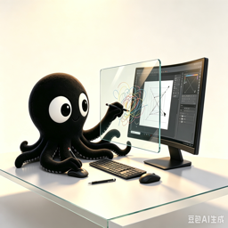
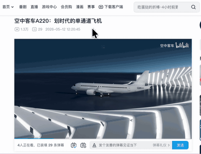
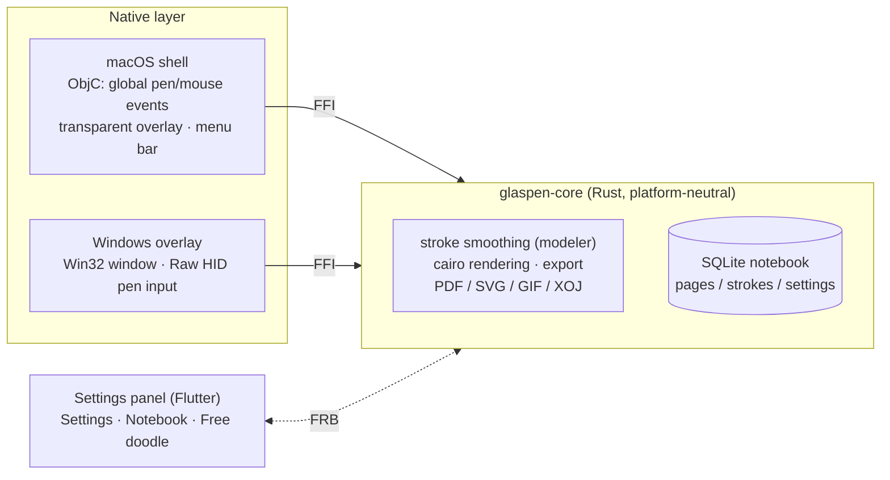

[中文](./README.md)

# Glaspen2

Separates the pen from the mouse.  
Like writing on a glass overlay in front of your monitor.

A regular stylus is treated as a mouse by the OS — this app removes that behavior.  
Ideal for remote meetings, teaching, screen annotation, and quick notes.

## Platforms

- macOS 12+ (current release: Apple Silicon / arm64)
- Windows 10/11 x64 (reads the pen via Raw HID; pressure works, no Microsoft Ink required)

## Two canvas modes

Switch from the tabs at the top of the settings panel, or the "Infinite canvas" menu item. The two modes store strokes **independently**.

- **Notebook (paged) mode** — one page per screen, classic page flipping (whole-page flip with the native window fade)
  - ``⌘⌃` `` / `⌘⌃1`: flip a whole page to previous / next (configurable in Settings → Shortcuts).
  - Page grid: **drag to reorder / batch multi-select delete**, plus lasso **move / copy / paste** in the full-page view.
- **Infinite canvas (free doodle) mode** — one canvas with no borders (currently a single global canvas)
  - Free doodle (infinite canvas) has no default shortcut; bind it in Settings → Shortcuts.
  - Left-hand camera: `⌃⌥W / ⌃⌥S / ⌃⌥A / ⌃⌥D` to pan; `⌃⌥Z / ⌃⌥X` to zoom
    (both configurable in Settings → Shortcuts).
  - `⌃⌥scroll` zooms anchored at the pointer (capped at 100%; modifiers follow the keyboard Zoom-in action).
  - `⌃⌥ + left-drag` is a temporary hand tool; drag to pan (modifiers follow the keyboard Pan-up action).
  - Panel "Edit content": lasso / drag to move / copy / paste / delete (shares the page clipboard).

## Features

- **Quick GIF recording**
  Hold `⌘⌃R`, doodle, release — the doodle is turned into an animated GIF and copied to the clipboard.
  Frame rate / resolution / playback speed are configurable in settings.

- **Export** screenshot with background / screenshot without background / Xournal notes / SVG / GIF / PDF
  The infinite canvas has its own exports: a **paged PDF** sized to the screen, or a **whole-canvas SVG** (content bounding box, unaffected by the current lens).

- **Grid** adjustable spacing; a heavier boundary line is drawn only at multiples of the screen size (page boundary in Notebook mode, one per screen on the infinite canvas).
  Optional **column guides**: halves, a 3×3 grid, or Cornell (30% cue column + 75% summary line; purely visual).

- **Stroke outline / soft shadow** outline = black-and-white marching-ants dashes so strokes read on light or dark backgrounds; soft shadow = a gentle dark halo under the strokes, keeps them visible on same-color backgrounds. Both can be combined.

- **Color / width** full-saturation palette + 8 width presets.

- **Frosted glass background** blurs the desktop to make strokes stand out (mouse/keyboard still work with other apps).
  An experimental **true see-through** mode makes the cards fully transparent — the desktop behind the panel shows right through.

- **Pen buttons** with the driver set to Pen/Eraser or Eraser, pressing the pen button turns it into an eraser automatically (no configuration); set to Keyboard Key with a glaspen shortcut to flip pages / undo.

- **Pressure monitor / launch at login.**

- **Update check / auto-update** one-click check against GitHub releases; on macOS one-click auto-update (with automatic rollback).

- **Bezier smoothing** via ink-stroke-modeler removes hand tremor and supports pressure width.

## Architecture

- **Native layer**: macOS uses ObjC (global events + overlay window), Windows is pure Rust Win32 — the doodling experience lives entirely here.
- **glaspen-core**: the platform-neutral shared core — storage, smoothing, rendering, export and updates.
- **Settings panel**: Flutter, talking to Rust in-process via FRB; by default only "Settings + Notebook" tabs are shown, the settings page itself shows just Pen + About first and folds the rest under "More settings".

## Keyboard shortcuts

| Function | macOS | Windows |
| --- | --- | --- |
| Toggle drawing | `⌘ + ⌃ + V` | `Ctrl + Alt + V` |
| Undo last stroke | `⌘ + ⌃ + Z` | `Ctrl + Alt + Z` |
| Previous / next page (whole page) | ``⌘ + ⌃ + ` `` / `⌘ + ⌃ + 1` | ``Ctrl + Alt + ` `` / `Ctrl + Alt + 1` |
| Open settings | `⌘ + ⌃ + D` | `Ctrl + Alt + D` |
| Quit completely | `⌘ + ⌃ + ⇧ + Q` | `Ctrl + Alt + Shift + Q` |
| Quick GIF recording (hold) | `⌘ + ⌃ + R` | `Ctrl + Alt + R` (hold) |
| Infinite canvas: pan (four directions) | `⌃⌥ + W / A / S / D` | `Win + Alt + W / A / S / D` |
| Infinite canvas: mouse pan | `⌃⌥ + left-drag` | `Win + Alt + left-drag` |
| Infinite canvas: keyboard zoom | `⌃⌥ + Z / X` | `Win + Alt + Z / X` |
| Infinite canvas: zoom (cursor anchored) | `⌃⌥ + scroll` | `Win + Alt + scroll` |

On macOS only the core actions and the free-doodle camera keys are bound by
default. **Windows binds every action**: ethereal `Ctrl+Alt+X`, free doodle
`Ctrl+Alt+I`, clear `Ctrl+Alt+C`, export `Ctrl+Alt+G`, copy SVG `Ctrl+Alt+S`,
frosted glass `Ctrl+Alt+B`, color swap `Ctrl+Alt+Shift+C`, width swap
`Ctrl+Alt+Shift+W`.

Windows uses the same configurable shortcut system: Settings → More settings →
Shortcuts lets you record / clear / reset each action, and the on-screen keyboard
highlights the keys currently in use. Defaults are the Windows chords in the table
above; global hotkeys are suspended while recording, and the scroll-wheel zoom
modifiers follow the Zoom-in action after rebinding.

Quit is `⌘⌃⇧Q` on macOS (`⌘⌃Q` is the system lock screen, so it cannot be used)
and `Ctrl+Alt+Shift+Q` on Windows. Windows defaults use two families: core/toggle
actions = `Ctrl+Alt+letter` (Z/`/1/V, D settings, ⇧Q quit, C clear, G export,
S copy, B glass, X ethereal, I free doodle, ⇧C color, ⇧W width) and camera/zoom =
`Win+Alt+W/A/S/D` plus `X` zoom-in / `Z` zoom-out. If a `Win+Alt` chord is taken by
another app (W/D commonly are), it falls back to `Alt+Shift` + same key and the
panel shows the effective chord.
Quitting flushes queued stroke points, checkpoints
the WAL and also terminates the settings-panel process (a separate process on
Windows), so nothing is left behind for the next launch to clean up.

## Installation

Follow the on-screen guide to grant Accessibility and Screen Recording permissions (used for global shortcuts and for saving screenshots with background).

## Dev Environment

- macOS: Rust + Flutter
- Windows: Rust + Flutter

## Privacy

- Doodle data stays on this machine by default; update checks only contact GitHub, and no telemetry is collected.
- Handwritten messages / shared canvas / OCR are optional; nothing is sent unless a service address is configured.
- See [docs/privacy.md](./docs/privacy.md).
